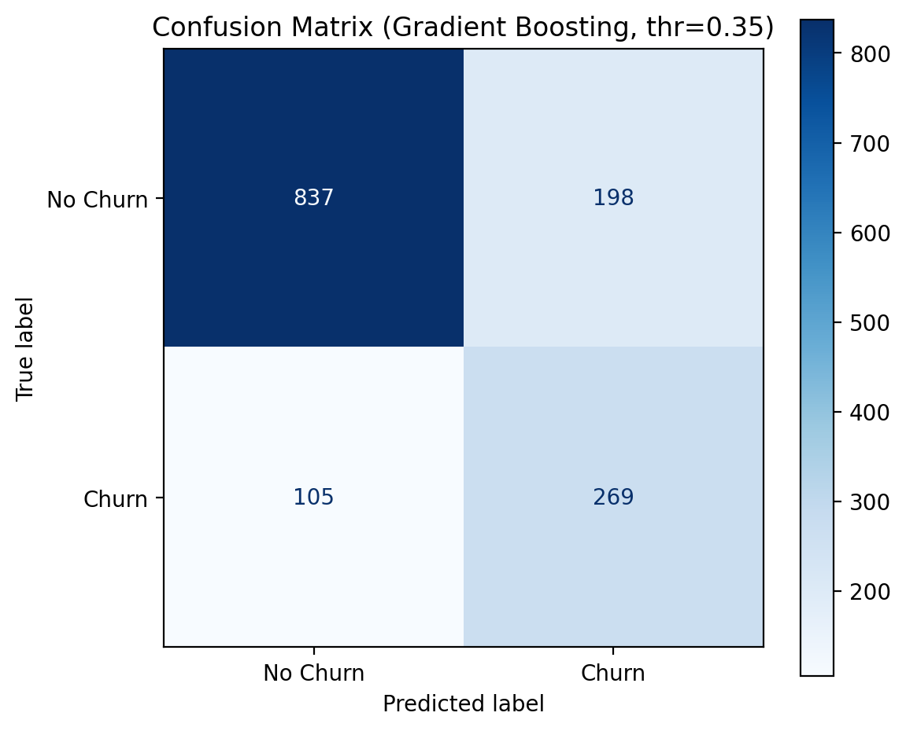
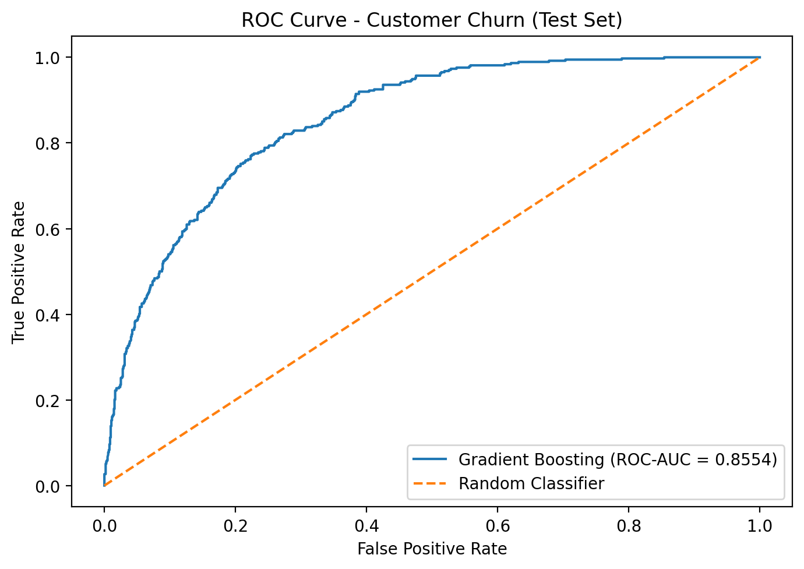
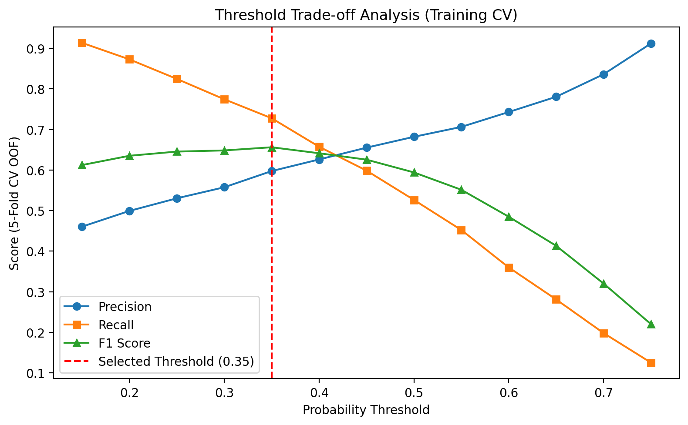

# 📊 Customer Churn Prediction

An end-to-end, reproducible Machine Learning project that predicts telecom customer churn risk, explains individual predictions using SHAP model-influence values, and serves single and batch predictions through an interactive Streamlit web application.

---

## 🚀 Live Demo

[Open Customer Churn Prediction App](https://customer-churn-k8scjyvcoug3dypgma84i9.streamlit.app/)

---

## 🎯 Problem Statement & Business Motivation

Acquiring a new telecom customer is typically far more expensive than retaining an existing one. Customer churn — when a subscriber cancels or stops using a service — directly erodes recurring revenue and Customer Lifetime Value (CLTV).

This project solves a **binary classification** problem: predicting whether a customer is likely to churn (`1`) or stay (`0`) along with a calibrated probability score and risk tier (`Low Risk`, `Medium Risk`, `High Risk`). Rather than optimizing accuracy alone, the pipeline explicitly balances **False Negatives** (missed churners leading to lost revenue) against **False Positives** (unnecessary retention offers) using probability threshold tuning on cross-validation predictions.

---

## 📂 Dataset Description & Source

- **Dataset:** IBM Telco Customer Churn (`data/raw/Customer_churn.csv`) — public IBM sample dataset for telecom customer retention analytics.
- **Size:** 7,043 customers × 33 original columns (0 duplicate rows)
- **Target Variable:** `Churn Label` (`No` = 5,174 / 73.46%, `Yes` = 1,869 / 26.54%)

### Features Used (20 Input Features)
After removing identifiers/constants (`CustomerID`, `Count`, `Country`, `State`, `Lat Long`), direct target-leakage columns (`Churn Value`, `Churn Score`, `Churn Reason`), and geographic coordinates (`City`, `Zip Code`, `Latitude`, `Longitude`), the model uses:
- **Numerical (4):** `Tenure Months`, `Monthly Charges`, `Total Charges` (11 blank strings coerced to `NaN` and median-imputed inside the training pipeline), `CLTV`
- **Categorical (16):** `Gender`, `Senior Citizen`, `Partner`, `Dependents`, `Phone Service`, `Multiple Lines`, `Internet Service`, `Online Security`, `Online Backup`, `Device Protection`, `Tech Support`, `Streaming TV`, `Streaming Movies`, `Contract`, `Paperless Billing`, `Payment Method`

---

## 🔄 Machine Learning Workflow

```text
Raw Dataset (7,043 × 33)
  ↓  Clean & drop leakage columns (Total Charges blanks → NaN)
Stratified 80/20 Train/Test Split (5,634 train / 1,409 test)
  ↓  ColumnTransformer (Median Imputer + StandardScaler | Mode Imputer + OneHotEncoder)
5-Fold Stratified Cross-Validation & Hyperparameter Tuning (on Train only)
  ↓  Select Best Pipeline by CV ROC-AUC (Gradient Boosting)
Out-of-Fold CV Threshold Optimization (0.50 → 0.35 for higher churn recall)
  ↓  Single Final Evaluation on Untouched Test Set
Serialized Pipeline + Metadata + Permutation Importance + SHAP Explainability
  ↓
Streamlit Web Application (Single, Batch CSV, & Insights)
```

---

## 📊 Models Compared (5-Fold Stratified CV on Training Set)

| Model | CV Accuracy | CV Precision | CV Recall | CV F1 Score | CV ROC-AUC (Mean ± Std) |
| :--- | :---: | :---: | :---: | :---: | :---: |
| **Gradient Boosting** | **0.8092** | **0.6826** | 0.5264 | 0.5942 | **0.8645 ± 0.0108** |
| Random Forest | 0.7771 | 0.5573 | 0.7813 | 0.6504 | 0.8628 ± 0.0091 |
| Logistic Regression | 0.7575 | 0.5283 | 0.8100 | 0.6393 | 0.8590 ± 0.0126 |
| Decision Tree | 0.7481 | 0.5160 | 0.8147 | 0.6318 | 0.8454 ± 0.0135 |

---

## 🏆 Final Model Performance (Untouched Test Set, n = 1,409)

- **Selected Model:** Tuned `GradientBoostingClassifier` (`n_estimators=100`, `learning_rate=0.03`, `max_depth=4`, `subsample=0.8`)
- **ROC-AUC:** `0.8554` | **PR-AUC:** `0.6686`

| Decision Threshold | Accuracy | Precision | Recall | F1 Score | Confusion Matrix `[[TN, FP], [FN, TP]]` |
| :--- | :---: | :---: | :---: | :---: | :--- |
| Default (`0.50`) | 80.77% | 67.82% | 52.41% | 59.13% | `[[942, 93], [178, 196]]` |
| **CV-Tuned (`0.35`)** | **78.50%** | **57.60%** | **71.93%** | **63.97%** | **`[[837, 198], [105, 269]]`** |

Lowering the threshold from `0.50` to `0.35` (selected strictly from training-set CV out-of-fold probabilities) reduces missed churners (False Negatives) from **178 to 105**, increasing churn recall from **52.41% to 71.93%**.

---

## 📈 Visualizations

| Confusion Matrix | ROC Curve |
| :---: | :---: |
|  |  |

| Threshold Trade-off (CV) | Permutation Importance (Test Set) |
| :---: | :---: |
|  |  |

> **Application UI:** The Streamlit dashboard (`Customer Churn Intelligence`) provides 5 sidebar pages: **Dashboard** (executive KPIs, revenue at risk, and risk distribution), **Customer Prediction** (3-section form, High/Low-Risk presets, local SHAP drivers, retention actions, session history, and Batch CSV Scoring), **Analytics** (interactive filters), **Model Insights**, and **About Model**. Run locally with `streamlit run app.py`.

---

## 🛠️ Technologies Used

- **Python 3.12**
- **Data & ML:** `pandas`, `numpy`, `scikit-learn`, `joblib`, `shap`
- **Visualization:** `plotly`, `matplotlib`, `seaborn`
- **Web App, Testing & CI:** `streamlit`, `pytest`, `ruff`, GitHub Actions

---

## 📁 Project Structure

```text
Customer_Churn/
├── app.py                      # Streamlit entrypoint & sidebar navigation
├── run_pipeline.py             # End-to-end reproducible pipeline runner
├── requirements.txt            # Pinned runtime dependencies
├── requirements-dev.txt        # Pinned dev/training/testing/lint dependencies
├── ruff.toml                   # Ruff linter configuration
├── .github/workflows/ci.yml    # GitHub Actions CI (Ruff + pytest)
├── data/
│   ├── raw/Customer_churn.csv  # Original IBM Telco dataset (preserved)
│   ├── processed/              # Cleaned data and train/test splits
│   └── test/                   # Sample batch CSV for demo/testing
├── models/
│   ├── best_churn_pipeline.pkl # Full sklearn Pipeline (preprocessor + model)
│   ├── best_churn_model.pkl    # Classifier step
│   ├── preprocessor.pkl        # Fitted ColumnTransformer
│   └── model_metadata.json     # CV/test metrics, threshold, schema, version
├── reports/                    # Model comparison CSV & evaluation/EDA charts
├── src/
│   ├── config.py               # Central paths, schema, and constants
│   ├── data_understanding.py   # Raw dataset inspection
│   ├── data_preprocessing.py   # Leakage-free cleaning
│   ├── eda.py                  # Exploratory chart generation
│   ├── feature_engineering.py  # Validation, split, and ColumnTransformer
│   ├── train_model.py          # 5-fold CV, tuning, and threshold optimization
│   ├── evaluate_model.py       # Untouched test evaluation & permutation importance
│   ├── predict.py              # Inference, risk tiering, and local SHAP explanation
│   └── ui/                     # Modular SaaS theme, Plotly charts, loaders & pages
└── tests/
    └── test_churn_pipeline.py  # Automated pytest suite (including AppTest UI flows)
```

---

## ⚙️ Installation & Local Execution

```powershell
# 1. Create and activate a virtual environment
python -m venv venv
.\venv\Scripts\Activate.ps1

# 2. Install runtime + development dependencies
pip install -r requirements-dev.txt

# 3. Run the Streamlit web application
streamlit run app.py
```

### Regenerate the Model & Reports
```powershell
python run_pipeline.py
```

### Run CLI Sample Prediction & Automated Tests
```powershell
python -m src.predict
pytest -v
```

---

## ⚠️ Limitations & Future Improvements

- **Limitations:** Trained on a single static Telco dataset (7,043 rows); `CLTV` is an input feature whose real-world availability at onboarding may vary; SHAP values reflect model influence rather than causal proof.
- **Future Improvements:** Probability calibration (`CalibratedClassifierCV`), cost-sensitive threshold optimization with explicit retention campaign cost inputs, and drift monitoring for production data.
