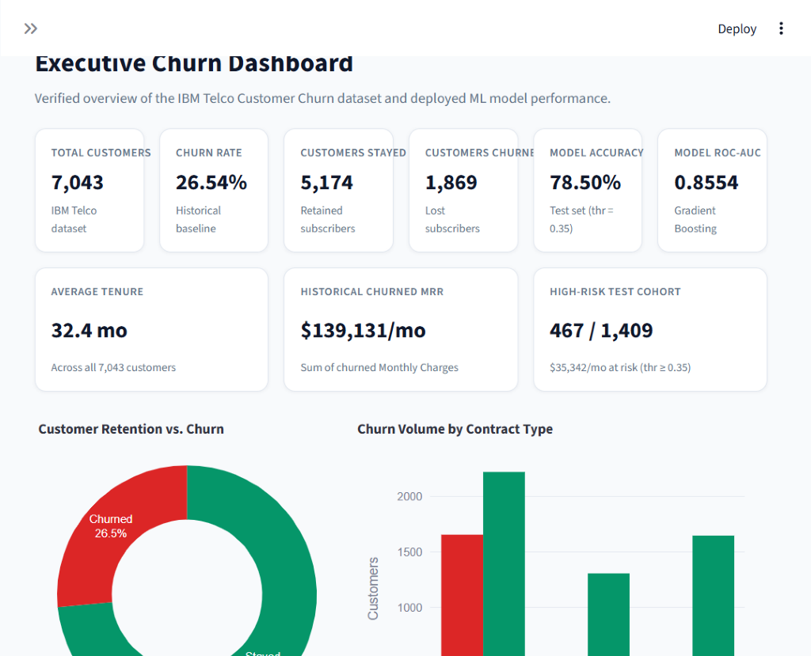
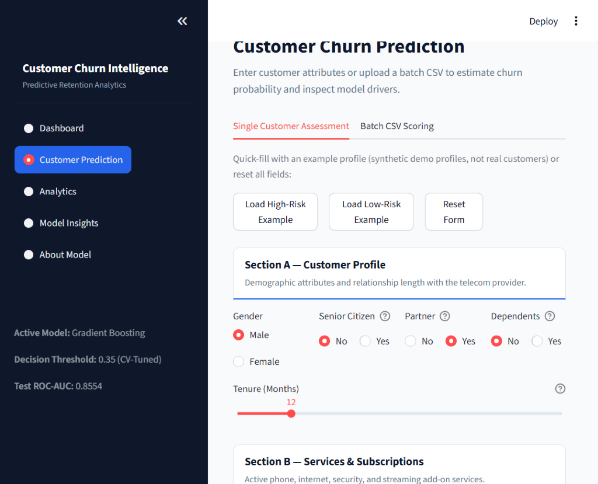
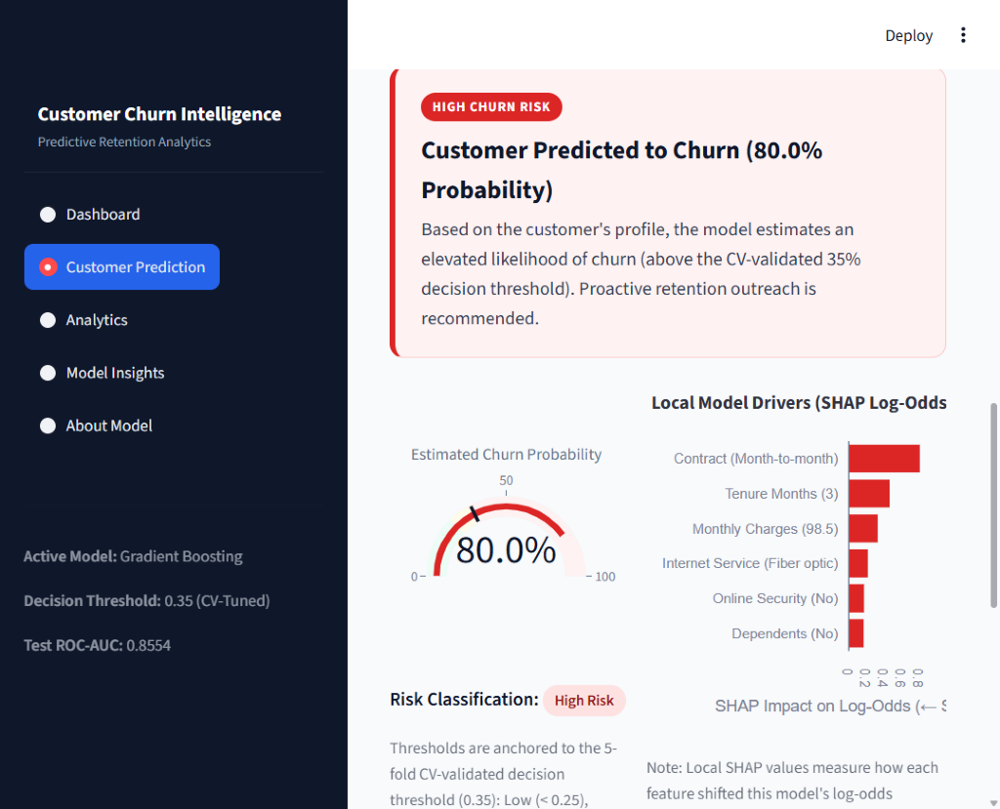
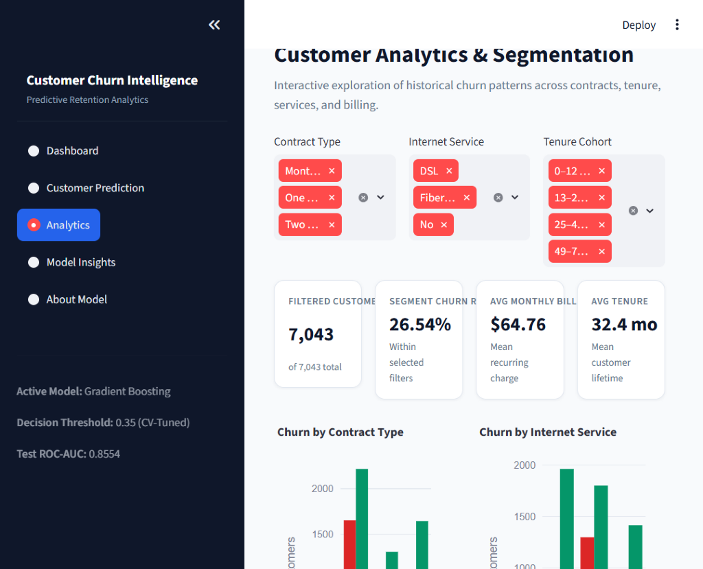
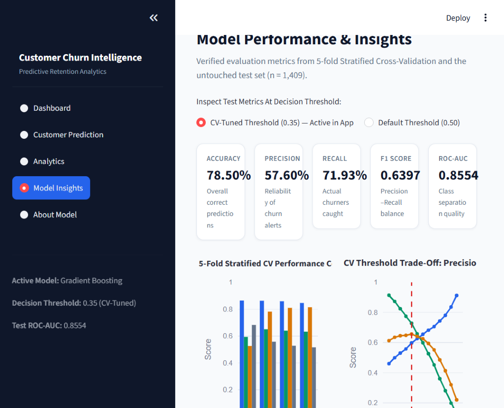
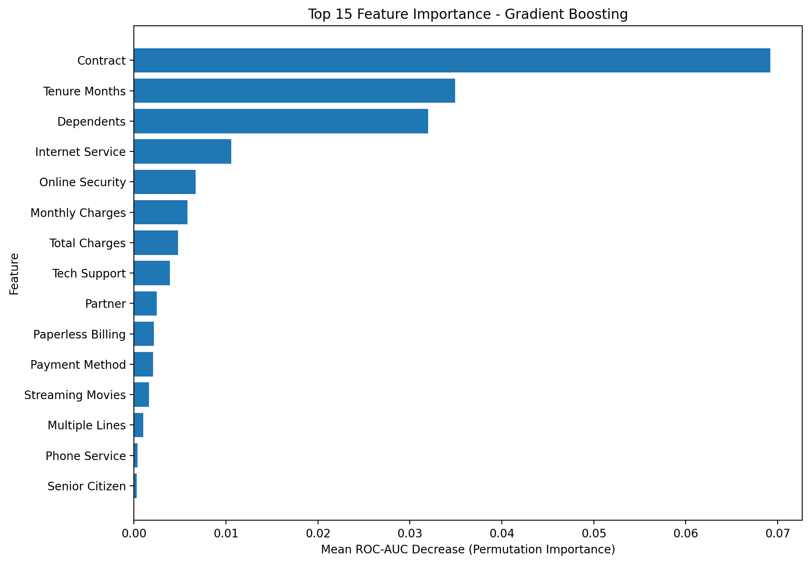

# Customer Churn Intelligence


An end-to-end, reproducible Machine Learning and customer analytics application that predicts telecom customer churn risk, explains individual predictions using local SHAP values, and serves single and batch predictions through a multi-page Streamlit dashboard.

---

## Live Application

- **Streamlit Community Cloud:** [Open Customer Churn Intelligence](https://customer-churn-k8scjyvcoug3dypgma84i9.streamlit.app/)

---

## Project Overview

This project turns raw telecom subscriber records into an interactive retention intelligence system. It combines a leakage-free `scikit-learn` pipeline (tuned with 5-fold Stratified Cross-Validation and out-of-fold probability threshold optimization) with a 5-page **Streamlit + Plotly** dashboard featuring executive KPIs, interactive segmentation, individual SHAP explanations, rule-based retention guidance, and batch CSV scoring.

### Key Features

- **5-Page Analytics Dashboard:** Executive Home, Customer Prediction (Single + Batch CSV), Interactive Analytics, Model Insights, and About Model.
- **Leakage-Free ML Pipeline:** Missing-value imputation, scaling, and one-hot encoding live inside a single serialized `sklearn.pipeline.Pipeline` fit strictly on the training split.
- **Business-Aligned Thresholding:** Decision threshold (`0.35`) tuned on training cross-validation probabilities to raise churn recall from `52.41%` to `71.93%` on the untouched test set.
- **Model Explainability:** Global Permutation Importance on the test set and local `shap.TreeExplainer` feature drivers aggregated back to the 20 original inputs.
- **Automated Quality Checks:** 10 `pytest` tests (including Streamlit `AppTest` UI flows), Ruff linting, and GitHub Actions CI.

---

## Problem Statement & Business Motivation

Acquiring a new telecom customer is significantly more expensive than retaining an existing one. Every lost subscriber directly reduces recurring revenue and Customer Lifetime Value (CLTV).

This project frames churn prediction as a **binary classification** problem (`0 = Stay`, `1 = Churn`) paired with calibrated probability risk tiers (`Low Risk`, `Medium Risk`, `High Risk`). In churn retention, **False Negatives** (missing a customer who leaves) are far costlier than **False Positives** (offering a retention incentive to a customer who would have stayed), so evaluation and threshold selection prioritize churn recall alongside ROC-AUC and precision.

---

## Dashboard Screenshots

### Executive Dashboard Overview


### Customer Prediction Form & High-Risk Result
| Structured 3-Section Prediction Form | Prediction Result, Gauge & SHAP Drivers |
| :---: | :---: |
|  |  |

### Interactive Analytics & Model Insights
| Customer Analytics & Segmentation | Model Performance & Insights |
| :---: | :---: |
|  |  |

---

## Interactive Dashboard Pages

1. **Dashboard:** Displays 9 verified KPI cards (Total Customers, Churn Rate, Stayed, Churned, Model Accuracy, Model ROC-AUC, Average Tenure, Historical Churned MRR, and High-Risk Test Cohort) plus 6 interactive Plotly charts.
2. **Customer Prediction:**
   - **Single Customer Assessment:** Organized into **Section A (Customer Profile)**, **Section B (Services & Subscriptions)**, and **Section C (Contract & Billing)**, with `Load High-Risk Example`, `Load Low-Risk Example`, `Reset Form`, local SHAP drivers, rule-based retention recommendations, and session prediction history.
   - **Batch CSV Scoring:** Upload a CSV with the 20 required feature columns, inspect summary risk KPIs, and download scored predictions.
3. **Analytics:** Filter historical customers by Contract Type, Internet Service, and Tenure Cohort with dynamically updating KPIs and 6 Plotly visualizations.
4. **Model Insights:** Toggle between the active **CV-Tuned Threshold (`0.35`)** and **Default (`0.50`)**, inspect 5-fold CV comparisons, threshold trade-off curves, confusion matrix, ROC curve, and permutation importance.
5. **About Model:** Documents pipeline architecture, leakage prevention, threshold rationale, and known limitations.

---

## Customer Churn Prediction Workflow

```text
Raw Dataset (data/raw/Customer_churn.csv, 7,043 × 33)
  ↓  Clean & drop identifiers / target-leakage columns (Total Charges blanks → NaN)
Stratified 80/20 Train/Test Split (5,634 train / 1,409 test, random_state=42)
  ↓  ColumnTransformer (Median Imputer + StandardScaler | Mode Imputer + OneHotEncoder)
5-Fold Stratified Cross-Validation & Hyperparameter Tuning (on Train only)
  ↓  Select Best Pipeline by CV ROC-AUC (Gradient Boosting)
Out-of-Fold CV Threshold Optimization (0.50 → 0.35 for higher churn recall)
  ↓  Single Final Evaluation on Untouched Test Set
Serialized Pipeline + Metadata + Permutation Importance + Local SHAP Explainability
  ↓
Streamlit Web Application (5-Page Dashboard + Batch CSV Scoring)
```

---

## Dataset, Preprocessing & Feature Engineering

- **Source:** IBM Telco Customer Churn sample dataset (`data/raw/Customer_churn.csv`).
- **Dimensions:** 7,043 rows × 33 original columns (0 duplicate rows).
- **Target Variable:** `Churn Label` (`No` = 5,174 / `73.46%`, `Yes` = 1,869 / `26.54%`), mapped to `0` and `1`.

### Data Preprocessing (`src/data_preprocessing.py`)
- Drops direct target-leakage columns (`Churn Value`, `Churn Score`, `Churn Reason`) and non-predictive identifiers/constants (`CustomerID`, `Count`, `Country`, `State`, `Lat Long`).
- Coerces `Total Charges` to numeric (`11` blank strings become `NaN`), deferring median imputation to the training pipeline so test statistics never leak into training.

### Feature Engineering (`src/feature_engineering.py`)
Drops geographic coordinates (`City`, `Zip Code`, `Latitude`, `Longitude`), leaving **20 validated input features**:
- **Numerical (4):** `Tenure Months`, `Monthly Charges`, `Total Charges`, `CLTV` → `SimpleImputer(strategy="median")` + `StandardScaler()`
- **Categorical (16):** `Gender`, `Senior Citizen`, `Partner`, `Dependents`, `Phone Service`, `Multiple Lines`, `Internet Service`, `Online Security`, `Online Backup`, `Device Protection`, `Tech Support`, `Streaming TV`, `Streaming Movies`, `Contract`, `Paperless Billing`, `Payment Method` → `SimpleImputer(strategy="most_frequent")` + `OneHotEncoder(handle_unknown="ignore", sparse_output=False)`

---

## Models Evaluated & Evaluation Methodology

Four candidate classifiers were tuned using **5-fold Stratified Cross-Validation** (`GridSearchCV` / `RandomizedSearchCV` scoring `roc_auc`) strictly on the 80% training split (`n = 5,634`):

| Model | CV Accuracy | CV Precision | CV Recall | CV F1 Score | CV ROC-AUC (Mean ± Std) |
| :--- | :---: | :---: | :---: | :---: | :---: |
| **Gradient Boosting** | **0.8092** | **0.6826** | 0.5264 | 0.5942 | **0.8645 ± 0.0108** |
| Random Forest | 0.7771 | 0.5573 | 0.7813 | 0.6504 | 0.8628 ± 0.0091 |
| Logistic Regression | 0.7575 | 0.5283 | 0.8100 | 0.6393 | 0.8590 ± 0.0126 |
| Decision Tree | 0.7481 | 0.5160 | 0.8147 | 0.6318 | 0.8454 ± 0.0135 |

**Threshold Selection:** Using out-of-fold CV probabilities on `X_train`, the decision threshold was swept from `0.15` to `0.75` (`0.05` steps). Threshold **`0.35`** was selected to maximize F1 among thresholds achieving Recall ≥ `0.65`.

---

## Final Model Performance (Untouched Test Set, n = 1,409)

- **Selected Model:** Tuned `GradientBoostingClassifier` (`n_estimators=100`, `learning_rate=0.03`, `max_depth=4`, `subsample=0.8`)
- **ROC-AUC:** `0.8554` | **PR-AUC:** `0.6686`

| Decision Threshold | Accuracy | Precision | Recall | F1 Score | Confusion Matrix `[[TN, FP], [FN, TP]]` |
| :--- | :---: | :---: | :---: | :---: | :--- |
| Default (`0.50`) | 80.77% | 67.82% | 52.41% | 59.13% | `[[942, 93], [178, 196]]` |
| **CV-Tuned (`0.35`)** | **78.50%** | **57.60%** | **71.93%** | **63.97%** | **`[[837, 198], [105, 269]]`** |

Lowering the threshold from `0.50` to `0.35` reduces missed churners (False Negatives) from **178 to 105**, raising churn recall from **52.41% to 71.93%**.

| Confusion Matrix (Test Set) | Global Permutation Importance (Test Set) |
| :---: | :---: |
|  |  |

---

## Explainability

- **Global:** Model-agnostic `permutation_importance` on the untouched test set identifies `Contract`, `Tenure Months`, `Dependents`, and `Internet Service` as the strongest contributors to ROC-AUC.
- **Local:** `shap.TreeExplainer` computes per-customer feature contributions on the preprocessed features and aggregates them back to the 20 original inputs. SHAP outputs indicate **model influence and statistical association, not causal proof**.

---

## Technology Stack

- **Language:** Python 3.12
- **Data & ML:** `pandas==3.0.1`, `numpy==2.4.6`, `scikit-learn==1.9.0`, `joblib==1.5.3`, `shap==0.52.0`
- **Visualization:** `plotly==7.2.0`, `matplotlib==3.10.0`, `seaborn==0.13.2`
- **Web App, Testing & CI:** `streamlit==1.60.0`, `pytest==9.2.0`, `ruff==0.17.6`, GitHub Actions

---

## Project Directory Structure

```text
Customer_Churn/
├── .github/workflows/ci.yml    # GitHub Actions CI (Ruff + pytest)
├── app.py                      # Streamlit entrypoint & sidebar navigation
├── run_pipeline.py             # End-to-end reproducible pipeline runner
├── requirements.txt            # Pinned runtime dependencies
├── requirements-dev.txt        # Pinned dev/training/testing/lint dependencies
├── ruff.toml                   # Ruff linter configuration
├── assets/screenshots/         # Real captured dashboard screenshots
├── data/
│   ├── raw/Customer_churn.csv  # Original IBM Telco dataset (preserved)
│   ├── processed/              # Cleaned data and train/test splits
│   └── test/                   # Sample batch CSV (sample_batch_customers.csv)
├── models/
│   ├── best_churn_pipeline.pkl # Full sklearn Pipeline (preprocessor + model)
│   ├── best_churn_model.pkl    # Classifier step
│   ├── preprocessor.pkl        # Fitted ColumnTransformer
│   └── model_metadata.json     # CV/test metrics, threshold, schema, version
├── reports/                    # Model comparison CSV & evaluation/EDA charts
├── src/
│   ├── config.py               # Central paths, schema, and constants
│   ├── data_understanding.py   # Raw dataset inspection
│   ├── data_preprocessing.py   # Leakage-free cleaning
│   ├── eda.py                  # Exploratory chart generation
│   ├── feature_engineering.py  # Validation, split, and ColumnTransformer
│   ├── train_model.py          # 5-fold CV, tuning, and threshold optimization
│   ├── evaluate_model.py       # Untouched test evaluation & permutation importance
│   ├── predict.py              # Inference, risk tiering, and local SHAP explanation
│   └── ui/                     # Modular SaaS CSS, Plotly charts, loaders & pages
└── tests/
    └── test_churn_pipeline.py  # Automated pytest suite (10 tests incl. AppTest)
```

---

## Installation & Local Execution

```powershell
# 1. Clone the repository
git clone https://github.com/ritura17/Customer-Churn.git
cd Customer-Churn

# 2. Create and activate a virtual environment
python -m venv venv
.\venv\Scripts\Activate.ps1

# 3. Install runtime and development dependencies
pip install -r requirements-dev.txt

# 4. Launch the Streamlit dashboard
streamlit run app.py
```

### Regenerate the Model & Reports
```powershell
python run_pipeline.py
```

### How to Use the Application
1. Open the **Dashboard** page to review dataset KPIs, revenue at risk, and test-cohort risk distribution.
2. Open **Customer Prediction** to either score a single customer (using presets or custom inputs) and inspect their probability gauge, SHAP drivers, and retention actions, or switch to **Batch CSV Scoring** and upload `data/test/sample_batch_customers.csv`.
3. Explore segments in **Analytics** and verify CV/test metrics in **Model Insights**.

---

## Testing & Code Quality

```powershell
# Run automated unit, pipeline, batch CSV, and Streamlit AppTest suite
python -m pytest -v

# Run Ruff linter
ruff check src tests app.py run_pipeline.py
```

---

## Limitations & Future Improvements

- **Limitations:** Trained on a static 7,043-row public IBM Telco dataset; `CLTV` availability may vary in real-time onboarding; session prediction history is stored in `st.session_state` (resets on browser reload); SHAP values explain model behavior rather than causal relationships.
- **Future Improvements:** Probability calibration (`CalibratedClassifierCV`), explicit retention-campaign ROI threshold optimization, and data-drift monitoring for production data.

---

## Author

- **GitHub:** [ritura17](https://github.com/ritura17)
- **Repository:** [ritura17/Customer-Churn](https://github.com/ritura17/Customer-Churn)
